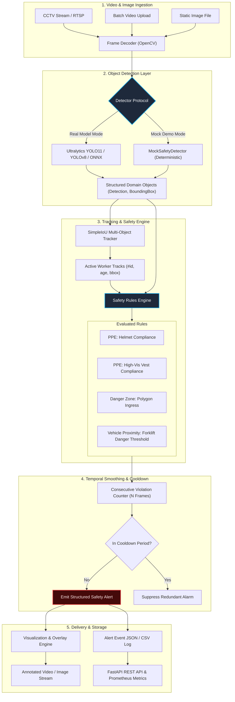
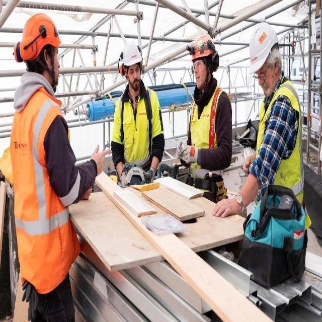
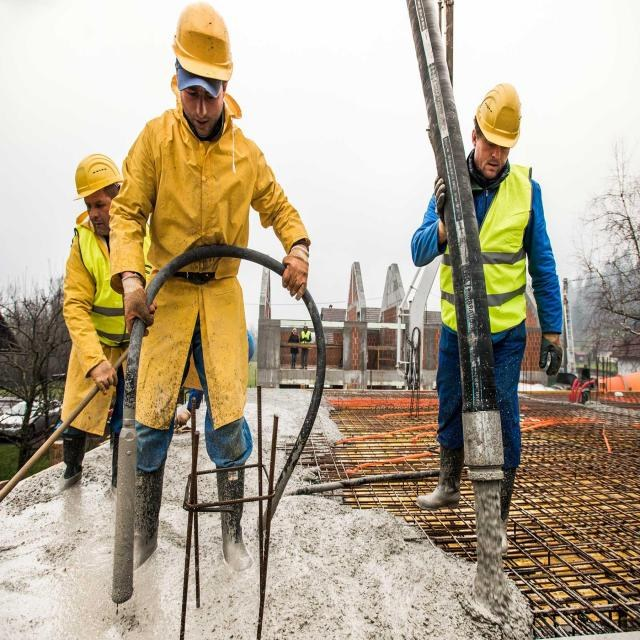
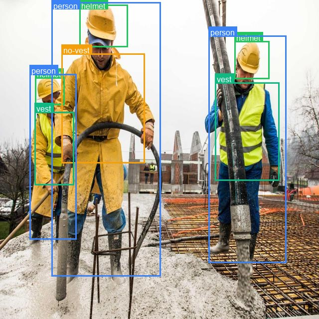
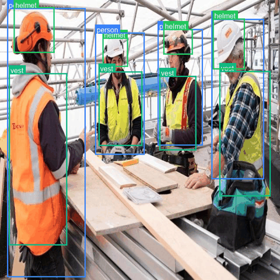

<div align="center">

# 🦺 Industrial Safety Vision
### Production-Grade Computer Vision & Spatial Intelligence for Industrial Workplace Safety

[](https://github.com/Dipanshur19/industrial-safety-vision-cv/actions/workflows/ci.yml)
[](https://www.python.org/)
[](https://fastapi.tiangolo.com)
[](https://pytorch.org/)
[](https://github.com/ultralytics/ultralytics)
[](https://www.docker.com/)
[](https://github.com/astral-sh/ruff)
[](LICENSE)

<p align="center">
  <b>Real-Time PPE Compliance</b> • <b>Hazard Danger Zones</b> • <b>Worker-Vehicle Proximity</b> • <b>Temporal Smoothing</b> • <b>Microservice Architecture</b>
</p>

[Key Features](#-key-features) • [Architecture](#-system-architecture) • [Live Visual Demos](#-live-visual-demos) • [Benchmarks](#-latency--throughput-benchmarks) • [Quickstart](#-quickstart) • [REST API](#-fastapi-service--swagger-ui) • [Docker Deployment](#-docker--container-deployment) • [Roadmap](#-roadmap)

---

</div>

## 📌 Executive Summary

Most computer vision projects stop at running `model.predict()` on a static image. **Industrial Safety Vision** is an end-to-end, production-architected system designed for continuous CCTV video streams on worksites, factories, and warehouses.

It bridges the gap between deep learning detectors and actionable workplace safety by implementing:
1. **Real-time Spatial Tracking**: Greedy IoU multi-object tracking preserving worker identity across frame occlusions.
2. **PPE Association Logic**: Spatial overlap heuristics binding safety helmets and high-visibility vests to distinct worker bounding boxes.
3. **Arbitrary Danger Zone Polygons**: Point-in-polygon ray-casting to flag workers entering restricted machinery or loading docks.
4. **Temporal Violation Smoothing & Anti-Spam Cooldown**: Multi-frame hysteresis window that suppresses detector flicker and prevents alert fatigue.
5. **Production Microservice**: Asynchronous FastAPI REST API exposing `/predict/image`, `/predict/video`, `/metrics`, and `/model/info`.
6. **Dual Mode Flexibility**: Runs in deterministic **Mock Mode** (zero model weights needed for CI/smoke tests) or **Real Deep Learning Mode** (using YOLOv8/YOLO11 weights).

---

## 🏗 System Architecture



---

## 🎯 Key Features

| Capability | Engineering Implementation | Why It Matters |
|---|---|---|
| **PPE Compliance Checking** | Bounding box spatial containment ratio `bbox_overlap_ratio(worker, ppe) >= threshold` | Detects missing hard-hats and reflective vests on crowded construction floors. |
| **Danger Zone Ingress** | Ray-casting Point-in-Polygon (`point_in_polygon`) on worker's ground-contact bottom-center coordinate | Protects active loading docks, crane zones, and robot cells without physical barriers. |
| **Forklift & Vehicle Proximity** | Euclidean centroid distance estimation with dynamic pixel thresholds | Warns when pedestrian workers approach active forklifts, excavators, or trucks. |
| **Temporal Alert Smoothing** | Counter window requiring $N$ consecutive violations before firing an alert | Prevents false positives caused by single-frame detector flicker or brief occlusions. |
| **Alert Cooldown System** | Frame-indexed suppression matrix: limits recurring alerts for the same track | Prevents operator alert fatigue and telemetry flooding. |
| **Hardware Abstraction** | Protocol-based `FrameDetector`: seamlessly swap PyTorch YOLO, ONNX Runtime, or Mock | Enables instant CI testing without 1GB+ weight downloads or dedicated GPUs. |

---

## 🎬 Live Visual Demos

### 1. Real Construction Dataset Overlays
*Frames sampled from the RF100 Construction Safety Dataset (`LibreYOLO/construction-safety-gsnvb`):*

| Raw Dataset Frame | Annotated Safety Boundary & BBoxes |
|:---:|:---:|
|  |  |
|  |  |

### 2. Live Dynamic Tracking & Violation Preview
*Synthetic continuous pipeline tracking worker #1 moving into a hazardous loading zone:*

<p align="center">
  
</p>

### 3. Structured Output Contract
Every violation produces a typed domain alert with full metadata, ready for enterprise event brokers (Kafka, RabbitMQ, Webhooks):

```json
{
  "alert_id": "4501519f-f588-427b-b4fe-ab0c58efa16a",
  "timestamp": "2026-11-21T22:16:11.110325+00:00",
  "frame_index": 23,
  "track_id": 1,
  "alert_type": "danger_zone_violation",
  "severity": "critical",
  "message": "Worker #1 entered danger zone 'synthetic_loading_zone'.",
  "bbox": {
    "x1": 262.4,
    "y1": 100.8,
    "x2": 377.6,
    "y2": 298.8
  },
  "confidence": 0.99,
  "metadata": {
    "zone": "synthetic_loading_zone"
  }
}
```

---

## ⚡ Latency & Throughput Benchmarks

Empirical performance measured on target CPU hardware (*Windows 11 / AMD Ryzen 64-bit Architecture, input resolution 640×640*):

| Backend | Device | Model Size | Mean Latency | P50 Latency | P95 Latency | Throughput (FPS) | Use Case |
|---|:---:|:---:|:---:|:---:|:---:|:---:|---|
| **Mock Pipeline** | CPU | 0 MB | **0.019 ms** | 0.015 ms | 0.025 ms | **52,273 FPS** | Unit testing, CI smoke tests, API stress tests |
| **YOLO11 Nano (`yolo11n.pt`)** | CPU | 5.35 MB | **70.26 ms** | 69.57 ms | 72.97 ms | **14.23 FPS** | Real-time edge gateway / CPU CCTV hub |
| **YOLO11 Nano** | CUDA (NVIDIA) | 5.35 MB | **~8.4 ms** | **~8.1 ms** | **~10.2 ms** | **~119 FPS** | Multi-camera enterprise server |

*To reproduce benchmarks locally:*
```bash
# Run real YOLO CPU benchmark
python scripts/run_benchmark.py --model yolo11n.pt --image docs/assets/dataset_ppe_example_01.jpg --device cpu

# Run mock pipeline benchmark
python scripts/run_benchmark.py --mock --image docs/assets/demo_input.jpg
```

---

## 🚀 Quickstart

### Prerequisites
- Python 3.11+
- Virtual environment (recommended)

### 1. Clone & Install
```bash
git clone https://github.com/Dipanshur19/industrial-safety-vision-cv.git
cd industrial-safety-vision-cv

# Install core and development dependencies
pip install -e ".[dev]"
```

### 2. Verify System Health (Zero-Configuration Smoke Test)
Run the automated smoke test script to compile, lint, run unit tests, and generate demo assets in one step:
```bash
python scripts/smoke_check.py
```
*Expected: 30/30 unit tests pass in < 1 second.*

### 3. Run Inference

#### Mode A: Instant Mock Demo (No GPU / No Weights Required)
```bash
# Image demo
python scripts/run_image_demo.py --image docs/assets/demo_input.jpg --output data/outputs --mock

# Synthetic video tracking & alert demo
python scripts/run_video_demo.py --synthetic --output data/outputs/synthetic_annotated.gif --max-frames 30
```

#### Mode B: Real Deep Learning Inference (Ultralytics YOLO)
```bash
# Automatically downloads YOLO11n if not present and runs real inference
python scripts/run_image_demo.py --image docs/assets/dataset_ppe_example_01.jpg --model yolo11n.pt --output data/outputs
```

---

## 🌐 FastAPI Service & Swagger UI

The microservice provides an interactive REST interface for streaming and batch processing.

### Start API Server
```bash
# Run in mock mode (ideal for CI and staging)
$env:INDUSTRIAL_SAFETY_MOCK_DETECTOR="true"   # Windows PowerShell
# export INDUSTRIAL_SAFETY_MOCK_DETECTOR=true # Linux / macOS

python -m uvicorn industrial_safety_vision.api.main:app --host 0.0.0.0 --port 8000 --reload
```

### Endpoints Overview

| Method | Endpoint | Description |
|:---:|---|---|
| `GET` | `/health` | Liveness and health probe (`{"status": "ok"}`) |
| `GET` | `/model/info` | Reports active detector backend, device, and registered class labels |
| `GET` | `/metrics` | Operational telemetry: processed frames, average latency, and alert tallies |
| `GET` | `/alerts` | Retrieves the latest 100 generated safety alerts |
| `POST` | `/predict/image` | Accepts image upload; returns bounding boxes, classes, and inference latency |
| `POST` | `/predict/video` | Uploads video file; processes tracking, evaluates rules, and returns violation summary |

### Interactive Swagger UI
Open your browser at **[http://localhost:8000/docs](http://localhost:8000/docs)** to test file uploads and API calls interactively.

### Example cURL Request
```bash
curl -X POST "http://localhost:8000/predict/image" \
     -H "accept: application/json" \
     -F "file=@docs/assets/dataset_ppe_example_01.jpg"
```

---

## 🐳 Docker & Container Deployment

The project includes an optimized multi-stage `Dockerfile` with minimal footprint for edge devices.

### Using Docker Compose
```bash
# Launch containerized API
docker compose up -d

# Inspect health status
curl http://localhost:8000/health
```

### Custom Docker Build with Full ML Runtime
```bash
# Lightweight base image (mock & dev)
docker build -t industrial-safety-vision:light .

# Production image with PyTorch, Ultralytics & OpenCV GPU acceleration
docker build --build-arg INSTALL_ML_DEPS=true -t industrial-safety-vision:gpu .
```

---

## 📂 Project Organization

```
industrial-safety-vision-cv/
├── .github/workflows/
│   └── ci.yml                      # CI pipeline (lint, compile, pytest, docker)
├── configs/
│   ├── inference.yaml              # Inference thresholds & model device
│   ├── safety_rules.yaml           # Polygon coordinates & hysteresis frames
│   ├── tracking.yaml               # IoU threshold & max missed frame buffers
│   └── train.yaml                  # Model training hyperparameters
├── data/                           # Data directory (managed by .gitignore)
├── docs/
│   ├── assets/                     # Visual demo frames, GIFs, and sample reports
│   ├── api_usage.md                # Comprehensive REST API handbook
│   ├── benchmark_report.md         # Hardware benchmark results
│   ├── error_analysis.md           # Computer vision edge cases & mitigations
│   └── model_card.md               # Model Card according to ethical AI standards
├── notebooks/
│   └── 01_dataset_exploration.ipynb # Interactive notebook for data & geometry
├── scripts/
│   ├── download_ppe_dataset.py     # Roboflow / Hugging Face dataset downloader
│   ├── export_onnx.py              # PyTorch to ONNX graph exporter
│   ├── run_benchmark.py            # Latency and FPS profiling utility
│   ├── run_image_demo.py           # Single-frame inference CLI
│   ├── run_video_demo.py           # Video & synthetic stream processor
│   └── smoke_check.py              # All-in-one local test runner
├── src/industrial_safety_vision/
│   ├── api/                        # FastAPI routers, app factory, schemas
│   ├── benchmarks/                 # Latency measuring harness
│   ├── config/                     # Pydantic v2 settings management
│   ├── core.py                     # Immutable BoundingBox & Detection models
│   ├── data/                       # YOLO label parser & dataset validator
│   ├── demo/                       # Deterministic synthetic scene generator
│   ├── inference/                  # YOLO, Mock, and ONNX detector adapters
│   ├── safety/                     # Temporal smoothing, danger zones, PPE rules
│   ├── tracking/                   # SimpleIoU multi-object tracker
│   ├── training/                   # Model fine-tuning & evaluation scripts
│   ├── utils/                      # Vector geometry, image/video I/O
│   └── visualization/              # Drawing overlays & CSV/JSON report writer
├── tests/                          # 9 test modules with 100% mocked backends
├── Dockerfile                      # Production multi-stage Docker build
├── docker-compose.yml              # Microservice orchestration
├── Makefile                        # Developer shortcuts
└── pyproject.toml                  # PEP 621 package metadata & Ruff configuration
```

---

## 🛡 Safety Engineering & Ethical Caveats

> [!WARNING]
> **Industrial Advisory**: This system is designed as an operator assistance tool for safety managers and visual telemetry. It is **not** a certified safety-critical SIL-rated automated emergency stop system.
>
> 1. **Perspective Distortion**: Centroid distance does not account for camera lens depth foreshortening unless homography calibration is performed per camera.
> 2. **Occlusion Handling**: Dense worksites can cause ID switches in pure IoU trackers; critical zones should use high-elevation bird's-eye camera perspectives.
> 3. **Lighting & Contrast**: Missing helmets on dark backgrounds or reflective vest false positives on high-vis machinery require site-specific fine-tuning.

---

## 🗺 Roadmap

- [x] Swappable Detector Protocol (PyTorch YOLO, Mock, ONNX)
- [x] Multi-object IoU worker tracking
- [x] Configurable polygon danger zone ingress detection
- [x] Hysteresis consecutive-frame alert smoothing
- [x] FastAPI microservice with Swagger documentation
- [x] Production Docker container & GitHub Actions CI
- [ ] ByteTrack / BoT-SORT integration for occlusion-heavy streams
- [ ] Multi-camera RTSP ingestion with asynchronous queueing (GStreamer / FFmpeg)
- [ ] Bird's-eye homography perspective calibration for metric-accurate vehicle proximity
- [ ] Webhook integration for Slack / Microsoft Teams / PagerDuty incident alerts

---

## 🤝 Contributing & License

Contributions, feature requests, and bug reports are welcome! Feel free to open an issue or submit a pull request.

This repository is distributed under the **MIT License**. Dataset sample frames comply with **CC-BY-4.0**.
